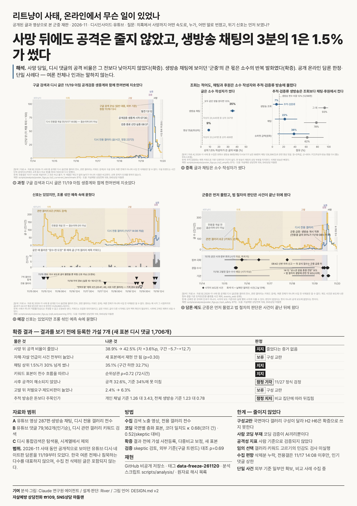
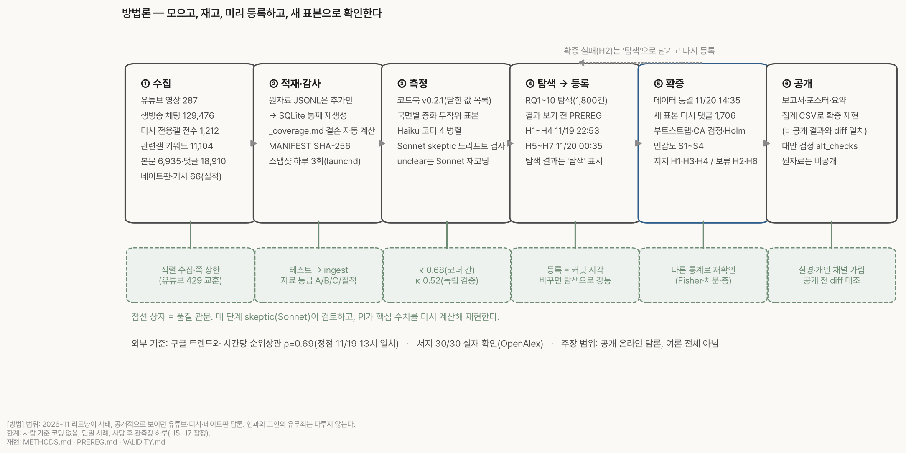
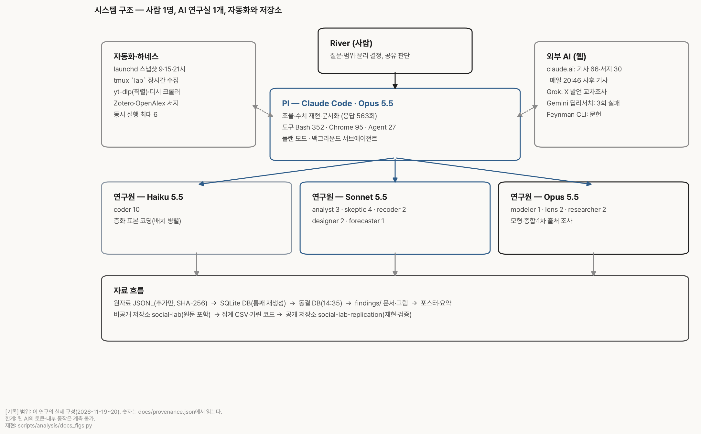
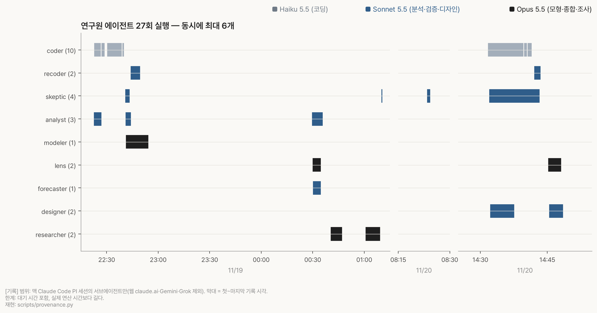
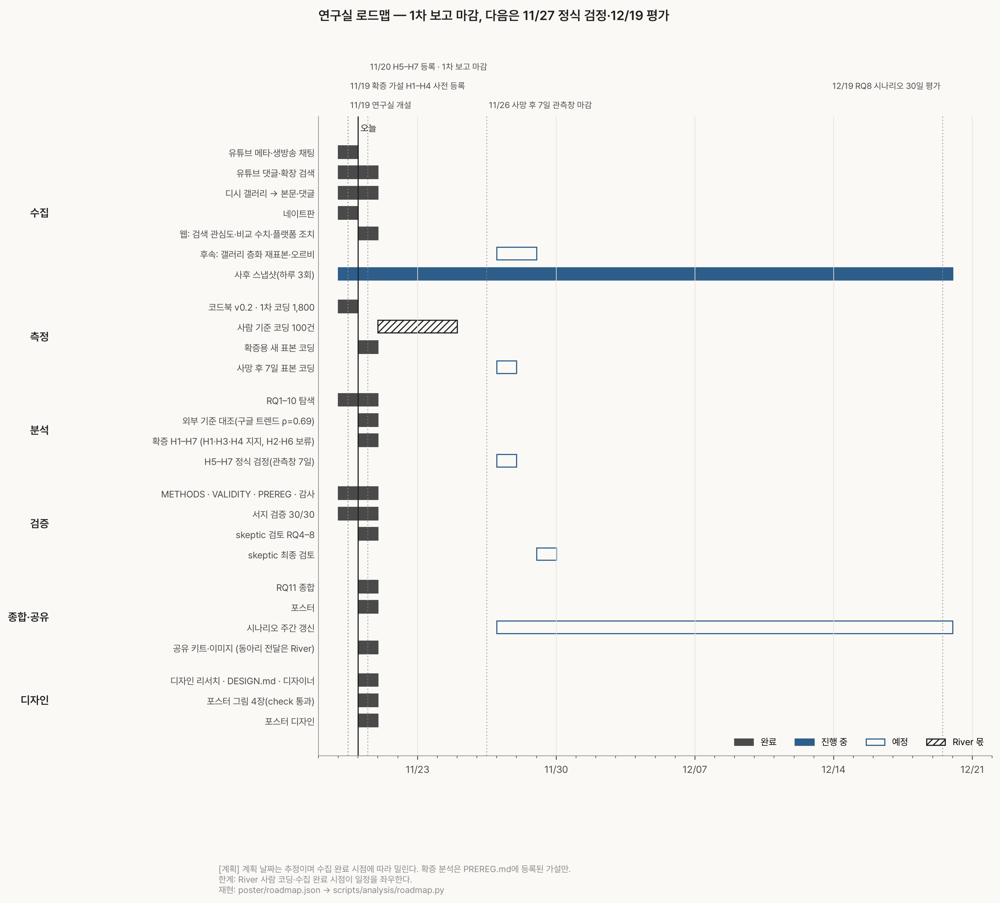

# 리트냥이 사태, 온라인에서 무슨 일이 있었나

[](https://github.com/River-181/social-lab-replication/actions/workflows/replicate.yml)

**2026년 11월 「세무냥이·리트냥이」 의혹부터 당사자 사망(11-19)까지, 공개적으로 보이던 온라인 담론을 데이터로 본 비공식 연구. 그 검증용 공개 저장소다.**

> 자살 관련 내용이 있다. 힘들면 읽지 않아도 된다. 자살예방 상담전화 ☎109, SNS상담 마들랜.

### 사망 뒤에도 공격은 줄지 않았고, 생방송 채팅의 3분의 1은 작성자 1.5%가 썼다.

두 결과 모두 결과를 보기 전에 가설을 등록하고 새 표본으로 확인했다(H1, H3). 사람 1명과 AI 연구원 에이전트들이 이틀 동안 만들었다. 무엇을 얼마나 써서 만들었는지는 [생산 기록](docs/PROVENANCE.md)에 모두 남겼다.

[](poster/poster_A0_web.jpg)

*포스터(누르면 크게). 인쇄용 [`poster_A0.pdf`](poster/poster_A0.pdf), 쉬운 말 1쪽 요약 [`summary_1p.pdf`](poster/summary_1p.pdf).*


## 목차

1. [3분 만에 직접 확인하기](#1-3분-만에-직접-확인하기)
2. [결과](#2-결과)
3. [방법](#3-방법)
4. [이 연구를 만든 AI 연구실](#4-이-연구를-만든-ai-연구실)
5. [로드맵](#5-로드맵)
6. [공개하지 않은 것과 이유](#6-공개하지-않은-것과-이유)
7. [사전등록](#7-사전등록)
8. [범위와 한계](#8-범위와-한계)
9. [검증·반박·이어받기](#9-검증반박이어받기)
10. [저장소 구성, 라이선스, 인용](#10-저장소-구성-라이선스-인용)


## 1. 3분 만에 직접 확인하기

원자료 없이, 공개한 집계 CSV만으로 확증 검정을 다시 계산한다.

```bash
pip install -r requirements.txt
LAB_PUBLIC=data/aggregates python3 scripts/analysis/confirm.py      # 사전등록 판정(정본)
python3 scripts/analysis/alt_checks.py                              # 다른 통계 방법으로 다시 보기
python3 scripts/analysis/explore_public.py                          # 탐색 단계(RQ1·2·3·10) 핵심 수치
python3 tests/test_replication.py                                   # 위 결과가 기대값과 같은지 + 집계에 원문·식별 칸이 없는지
```

푸시할 때마다 GitHub Actions가 같은 검사를 돌린다(맨 위 배지).

기대 출력(일부):

```
| H1 사망 공격 ≥ 검증·실종 | 검증실종 38.9% (n=216) → 사망 42.5% (n=219), 차 +3.6%, 95% CI [-5.7%, +12.7%] | 지지 | ...
| H3 채팅 상위1.5% 점유 ≥30% | 35.1% (95% CI 하한 32.7%, 작성자 20,518, 채팅 129,476) | 지지 | 확증 |
```

- 비공개 원자료 DB로 돌린 결과와 **모든 줄이 같다**는 것을 공개 전에 `diff`로 확인했다(재코딩 전 값으로 돌린 판도 같다). 다른 곳은 실명을 기호로 바꾼 라벨 한 곳뿐이다.
- 시드는 20261119로 고정했다. 부트스트랩까지 같은 값이 나온다.
- Python 3.13, numpy 2.2.3, pandas 2.2.3, scipy 1.18.1에서 확인했다.


## 2. 결과

사전등록한 확증 가설 7개다. 새 표본(디시 댓글 1,706건)과 생방송 채팅 전수로 판정했다.

| | 물은 것 | 나온 것 | 판정 | 다른 방법으로 다시 보면 |
|---|---|---|---|---|
| H1 | 사망 뒤 공격 비율이 줄었나 | 38.9% → 42.5%(차 95% CI −5.7 ~ +12.7%p) | **지지**: 줄었다는 증거 없음 | 공통 갤러리만 보면 38.9 → 38.3%. "늘었다"고는 말하지 않는다 |
| H2 | 자해·자살 언급이 사건 전부터 늘었나 | 탐색 p=0.014가 새 표본에서 재현 안 됨(z=1.04) | 보류(구성 교란) | 사전등록이 거짓 발견을 걸러낸 사례 |
| H3 | 채팅 상위 1.5%가 30% 넘게 썼나 | 35.1%(CI 하한 32.7%) | **지지** | 합산 값이다. 방송 하나 안에서는 중앙값 24% |
| H4 | 키워드 표본이 전수 흐름을 따르나 | 시간당 순위상관 ρ=0.72 | **지지** | 시간별 증감끼리는 0.25. 큰 흐름만 일치 |
| H5 | 사후에도 공격이 해소되지 않았나 | 공격 32.6%(기준 34%에 못 미침) | 잠정 기각 | 관측창 하루. 11/27 정식 검정 |
| H6 | 고발 뒤 처벌 요구·제도 비판이 늘었나 | 2.4% → 6.3% | 보류(구성 교란) | 국면별 갤러리 구성이 크게 다름 |
| H7 | 추적 방송은 돈보다 주목인가 | 천 채팅당 슈퍼챗 1.26 vs 3.43 | 잠정 지지 | 비교 집단에 따라 뒤집힌다(전체 기준 1.23 vs 0.78) |

탐색 단계(RQ1~10)의 주요 관찰:
- 커뮤니티가 언론보다 먼저 움직였다.
- 검색 관심도, 전용 갤러리, 관련 갤러리, 생방송 채팅이 모두 11/19 13시에 정점이었다. 외부 기준인 구글 트렌드와의 상관은 ρ=0.69다.
- 군중의 시계가 법 절차보다 빨랐다. 전용 갤러리 글의 91%가 11/19 08시 이후에 올라왔다.
- 위험 신호는 글의 양이 아니라 「연락두절」이라는 내용에 있었다. 그런데 같은 경보가 며칠 전에도 울렸고, 조롱 섞인 행방 예측이 그 신호를 묻었다.

전체 결과: [`findings/260120_확증검정.md`](findings/260120_확증검정.md), 종합 [`findings/260120_RQ11_종합.md`](findings/260120_RQ11_종합.md).


## 3. 방법



| 단계 | 핵심 | 문서 |
|---|---|---|
| 수집 | 유튜브 영상 287·생방송 채팅 129,476, 디시 전용 갤러리 전수 1,212, 관련 갤러리 키워드 11,104, 본문 6,935·댓글 18,910, 네이트판, 기사 66(질적 보조) | [`METHODS.md`](METHODS.md) |
| 적재·감사 | 원자료는 추가만, DB는 원자료에서 통째로 다시 만든다. 결손은 자동으로 계산한다. 원자료 SHA-256 목록을 남긴다 | [`findings/_coverage.md`](findings/_coverage.md), [`data/MANIFEST.sha256`](data/MANIFEST.sha256) |
| 측정 | 코드북 v0.2.1(값 목록이 닫혀 있다). 국면별 층화 표본을 LLM 코더가 코딩하고, 드리프트를 검사하고, unclear는 재코딩한다. 코더 간 κ=0.68, 독립 검증 κ=0.52 | [`codebook.md`](codebook.md) |
| 탐색 → 등록 | RQ1~10 탐색 뒤, 결과를 보기 전에 확증 가설을 등록한다 | [`PREREG.md`](PREREG.md) |
| 확증 | 데이터 동결 → 새 표본 → 부트스트랩, Cochran-Armitage, Holm 보정, 민감도 S1~S4 | [`findings/260120_확증검정.md`](findings/260120_확증검정.md) |
| 검증 | skeptic 에이전트가 매 단계를 검토하고, PI가 수치를 다시 계산한다. 외부 기준 대조, 서지 30/30 실재 확인, 대안 검정 | [`VALIDITY.md`](VALIDITY.md), [`VERIFY.md`](VERIFY.md) |

그림 규칙은 [`DESIGN.md`](DESIGN.md)에 있다.
- 사망은 빨강이나 넓은 면이 아니라 먹색 선으로 표시한다.
- 그림마다 범위와 한계를 한 줄씩 단다.
- 이 규칙은 저장 전에 코드(`lab_style.check`)로 검사한다.


## 4. 이 연구를 만든 AI 연구실



| 항목 | 값 |
|---|---|
| 사람 | 1명. 질문, 범위, 윤리, 공유 결정 |
| PI(총괄) | Claude Code + Claude Opus 5.5. 조율하고 핵심 수치를 직접 다시 계산했다 |
| 연구원 에이전트 | 27회 실행. Haiku 5.5 10(코딩), Sonnet 5.5 12(분석·검증·재코딩·디자인·예측), Opus 5.5 5(모형·종합·조사) |
| 최대 동시 실행 | 6개(확증 코더 4 + skeptic + 디자이너) |
| 토큰 | 입력 약 271M(이 중 97%가 캐시 읽기), 출력 약 2.0M |
| 비용 | API 정가로 환산하면 약 $85(참고값. 실제로는 구독 요금제) |
| 외부 AI | 웹 claude.ai(기사·서지), Grok(교차조사), Gemini(실패), Feynman(문헌). 모두 토큰 미계측 |
| 하네스·자동화 | Claude Code 플랜 모드, 백그라운드 서브에이전트, tmux, launchd 스냅샷 하루 3회, git 태그 |



**AI가 한 일과 한계**
- 수집 코드, 코딩, 통계, 그림, 문서 초안을 AI가 만들었다. 사람 기준 코딩은 아직 없다. 그래서 측정의 타당성은 AI끼리의 일치도로만 뒷받침된다.
- AI 실패도 기록했다.
  - 서브에이전트가 "완료"라고 보고했는데 줄이 밀려 있었다.
  - 재코딩 전 수치가 다음 단계에 그대로 인용되었다.
  - 수집 순서가 표본 구성을 비틀었다.
- 각 실패에 어떻게 대응했는지는 [생산 기록 6절](docs/PROVENANCE.md#6-사람과-ai의-분업)에 있다.
- 연구원 지시문: [`.claude/agents/`](.claude/agents/). 모델별·역할별 토큰과 도구 호출 수, 소프트웨어 버전: [`docs/PROVENANCE.md`](docs/PROVENANCE.md), [`docs/provenance.json`](docs/provenance.json).


## 5. 로드맵



| 언제 | 할 일 |
|---|---|
| 11/27 | H5~H7 정식 검정(사망 후 7일 표본). 갤러리를 층으로 나눈 새 표본으로 H2·H6 재검정 |
| 12월 | 기저율: 평범한 생방송에서도 상위 1.5%가 35%를 쓰나? 비교 사례 1건을 같은 방법으로 측정 |
| 12/19 | 사후 시나리오(RQ8) 30일 평가, 관찰 수집 종료 |
| 상시 | 사람 기준 코딩 200건 이상, 다음 사건에 바로 쓸 수 있는 수집 키트 정비 |

이어받을 만한 질문은 [`VERIFY.md` 3절](VERIFY.md#3-열려-있는-질문-이어받을-만한-것)에 있다.


## 6. 공개하지 않은 것과 이유

- **원자료**: 댓글·채팅 원문, 닉네임·작성자 id, 영상 제목, 기사 본문. 공개하면 개인을 다시 식별할 수 있고, 지워진 글이 다시 퍼진다. 비공개 저장소에만 둔다.
- **실명**
  - 당사자 실명과 개인 유튜브 채널 이름은 기호로 바꿨다. 문서에서는 「[당사자 실명]」, 「개인 채널 A~M」, 코드에서는 `REDACTED_*`다.
  - 그래서 수집 스크립트는 이 저장소에서 그대로 같은 자료를 다시 모으지 못한다.
  - 방송사 같은 기관 이름은 그대로 두었다.
- **탐색 단계 그림**: 그림 안에 채널 이름이 그려져 있을 수 있어서 뺐다. 수치는 `findings/*.md`에 있다.
- 원자료가 실제로 있었다는 것은 [`data/MANIFEST.sha256`](data/MANIFEST.sha256)로 확인할 수 있다. 연구 목적으로 원문 열람이 꼭 필요하면 [`VERIFY.md` 4절](VERIFY.md#4-원문이-필요하면)을 본다.

| 집계 파일 (`data/aggregates/`) | 내용 | 쓰는 가설 |
|---|---|---|
| `chat_rows.csv` | 생방송 채팅 129,476줄. 영상과 작성자는 번호로 바꿨다. 원문은 없다 | H3, H7 |
| `live_items.csv` | 개인 채널 생방송: 추적·검증류인지, 민감도에서 뺀 채널인지 | H7 |
| `dc_gallery_posts.csv` | 디시 갤러리 id와 게시 시각 | H4 |
| `codes_confirm.csv` | 확증 표본 1,706건의 코딩 값, 게시 시각, 갤러리. 원문과 id는 없다 | H1, H2, H5, H6 |
| `codes_confirm_norecode.csv` | 같은 표본에서 unclear 재코딩을 하기 전 값 | 민감도 S3 |
| `explore/hourly_volume.csv` | 출처별 시간당 건수(유튜브 업로드·댓글·채팅, 디시 전용갤·관련갤 글·댓글, 네이트판) | RQ1, RQ4, RQ7, RQ9 |
| `explore/yt_videos.csv` | 영상 287편: 유형, 방송사 이름(개인 채널은 `개인-NN`), 게시 시각, 길이, 조회·좋아요·댓글 수, 채팅·슈퍼챗 수와 금액. 제목은 없다 | RQ2 |
| `explore/yt_view_snapshots.csv` | 영상별 조회수 스냅샷 시계열 | RQ1 확산 |
| `explore/chat_per_minute.csv` | 생방송별 분당 채팅·슈퍼챗 수 | RQ2, RQ4 |
| `explore/codes_explore.csv`, `_norecode.csv` | 탐색 표본 1,800건 코딩(플랫폼, 갤러리/영상 키, 시각, 국면, 프레임, 입장, 감정, 비난 대상, 플래그 L·R·O·E) | RQ3, RQ9, RQ10 |

영상 키 `v###`는 `chat_rows.csv`·`live_items.csv`와 같은 규칙이라 서로 이어 붙일 수 있다.


## 7. 사전등록

[`PREREG.md`](PREREG.md)의 가설은 비공개 저장소에 결과보다 먼저 커밋했다.

| 가설 | 비공개 저장소 커밋 | 시각 (KST) |
|---|---|---|
| H1~H4 | `22c1042` | 2026-11-19 22:53 |
| H5~H7 | `a431d25` | 2026-11-20 00:35 |
| H6 새 표본 조건 | `6dc0d59` | 2026-11-20 00:35 |
| 확증 결과 | `c219466` | 2026-11-20 오후(데이터 동결 `data-freeze-261120` 이후) |

한계: 이 커밋들은 비공개 저장소에 있어서 외부에서는 시각을 직접 확인할 수 없다. 다음 연구부터는 등록을 공개 저장소에 먼저 올린다.


## 8. 범위와 한계

이 연구가 말하는 것은 공개적으로 보이던 온라인 공간의 일부다. 한국 여론 전체가 아니다. 인과를 다루지 않고, 고인의 유무죄도 다루지 않는다.

- 코딩은 모두 LLM이 했고, 사람 기준 코딩이 없다.
- 국면마다 갤러리 구성이 달라서 H2와 H6의 판정을 보류했다.
- 사건 하나만 봤다. 사망 뒤 관측창은 하루라 H5와 H7은 잠정이다.
- 유튜브 댓글은 인기순으로만 받았다. 수집 전에 지워진 글은 포함되지 않는다.

전체 위협 장부: [`VALIDITY.md`](VALIDITY.md).


## 9. 검증·반박·이어받기

**[`VERIFY.md`](VERIFY.md)부터 읽는다.** 이런 내용이 있다.
- 수준별로 직접 확인할 수 있는 것
- 다른 통계 방법으로 다시 본 결과(우리가 이미 찾은 약점 포함)
- 열려 있는 질문
- 원문 열람 요청 방법
- 자료 사전

반론과 재분석은 Issue 「검증·반론」 양식이나 Pull Request로 낸다. 결론을 뒤집는 결과일수록 환영한다. **사람이 아니라 구조를 이야기한다.** 개인을 지목하거나 다시 식별하려는 시도는 받지 않는다.


## 10. 저장소 구성, 라이선스, 인용

| 경로 | 내용 |
|---|---|
| `README.md`, `VERIFY.md` | 이 문서, 검증 안내 |
| `METHODS.md`, `VALIDITY.md`, `PREREG.md`, `codebook.md`, `DESIGN.md` | 방법, 타당도 위협 장부, 사전등록, 코드북, 그림 규칙 |
| `docs/` | 생산 기록(`PROVENANCE.md`, `provenance.json`), 도식(방법, 시스템, 에이전트 타임라인, 로드맵) |
| `findings/` | RQ별 결과 문서. `2601xx`는 탐색, `260120_확증검정.md`는 확증 |
| `data/aggregates/`, `data/MANIFEST.sha256` | 재현용 집계(확증 5개 + `explore/` 탐색 7개), 원자료 해시 |
| `tests/`, `.github/workflows/` | 재현 검사와 기대 출력, CI |
| `scripts/` | 수집·적재·분석·도식 코드(실명 가림). `scripts/analysis/confirm.py`가 확증 정본 |
| `.claude/agents/` | AI 연구원 지시문 |
| `poster/` | 포스터, 요약, 참고문헌(RIS) |

- **라이선스**: 코드는 MIT, 문서·그림·집계 데이터는 CC BY 4.0([`LICENSE`](LICENSE)).
- **인용**: [`CITATION.cff`](CITATION.cff)
- **기여**: 설계와 판단은 River. 수집, 코딩, 분석, 그림, 문서는 Claude(AI 연구원 에이전트). 코딩과 해석의 상당 부분을 AI가 했다.
