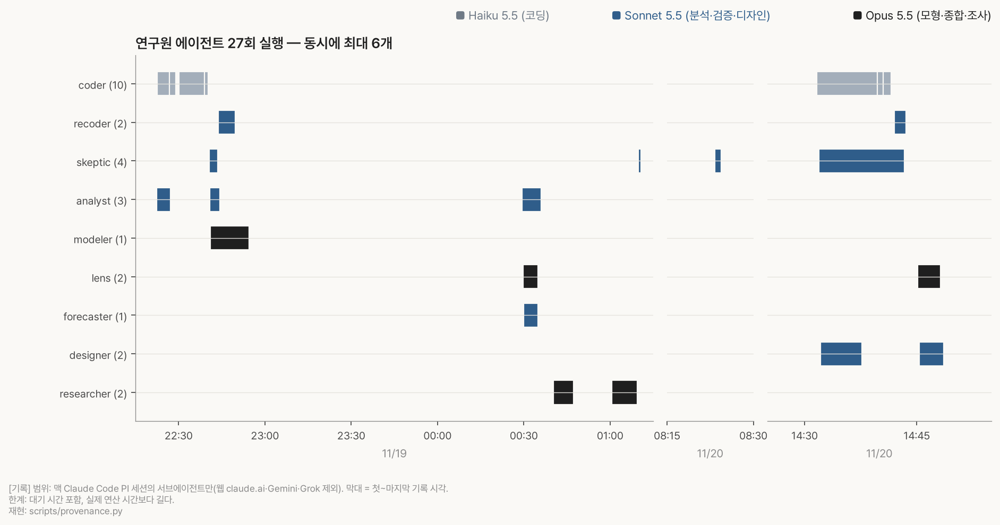

# 생산 기록 (PROVENANCE) — 이 연구를 무엇이, 얼마나 써서 만들었나

AI가 수집 코드, 코딩, 분석, 그림, 글의 대부분을 만든 연구다. 그래서 어떤 모델을 어떤 역할로 몇 번 썼고, 토큰을 얼마나 썼고, 무엇을 동시에 돌렸는지도 방법의 일부로 남긴다. 이 기록은 같은 연구를 다시 할 때 드는 비용을 가늠하는 근거가 되고, AI 산출물을 얼마나 믿을지 판단하는 데도 쓰인다.

- 기계용 원본: [`provenance.json`](provenance.json). 다시 만드는 법: `python3 scripts/provenance.py <세션 기록.jsonl>`(세션 기록은 비공개다).
- 계측 범위: 맥 Claude Code PI 세션 1개와 그 서브에이전트 27개, **2026-11-19 17:08 ~ 2026-11-20 15:56 KST**.
- **상한값이다.** PI 세션에는 연구 외 요청(아침 브리핑, 메시지 전송 등)이 일부 섞여 있고, 이를 분리할 수 없다. 웹 AI의 토큰은 계측할 수 없어 빠져 있다(아래 4절).

## 1. 한눈에

| 항목 | 값 |
|---|---|
| 사람 | 1명(River): 질문, 범위, 윤리, 공유 결정 |
| PI(총괄) | Claude Code 2.1.323 · Claude Opus 5.5, 응답 563회 |
| 연구원 에이전트 | 27회 실행(Haiku 10 · Sonnet 12 · Opus 5) |
| 최대 동시 실행 | 에이전트 **6개**(2026-11-20 14:32, 확증 코더 4 + skeptic + 디자이너) |
| 총 처리 토큰 | 입력 271.16M(이 중 캐시 읽기 263.81M), 출력 2.03M |
| API 정가 환산 | 약 **$85.24** (참고값. 실제로는 구독 요금제로 썼다. 캐시 쓰기는 5분 TTL 단가로 가정했고, 1시간 TTL이면 더 높다) |

## 2. 모델별 토큰

| 모델 | 입력 합계 | 캐시 읽기 | 캐시 쓰기 | 출력 |
|---|---|---|---|---|
| Claude Haiku 5.5 | 22.01M | 19.84M | 2.17M | 1.05M |
| Claude Opus 5.5 | 224.76M | 221.29M | 3.46M | 0.63M |
| Claude Sonnet 5.5 | 24.38M | 22.67M | 1.71M | 0.35M |

- 입력의 대부분이 캐시 읽기다. 긴 대화와 같은 지시문이 되풀이되기 때문이다. 캐시 덕분에 실제 비용은 입력 토큰 수에 비해 훨씬 작다.
- 출력은 코더(Haiku)가 가장 많다. 1,800 + 1,706건을 한 줄씩 코딩했기 때문이다.
- 단가 출처: Anthropic 공식 가격(2026-11 기준). Opus 5.5 $4/$20, Sonnet 5.5 $2/$10, Haiku 5.5 $0.10/$0.50(입력/출력, 백만 토큰당). 캐시 읽기는 Opus·Sonnet 0.05×, Haiku는 0.1×로 가정했다.

## 3. 역할별 연구원 에이전트

| 역할 | 모델 | 실행 | 출력 토큰 | 실행 시간 합 |
|---|---|---|---|---|
| 코더 | Claude Haiku 5.5 | 10 | 1.05M | 77분 |
| skeptic(검증) | Claude Sonnet 5.5 | 4 | 0.09M | 16분 |
| 분석 | Claude Sonnet 5.5 | 3 | 0.11M | 15분 |
| 디자이너 | Claude Sonnet 5.5 | 2 | 0.06M | 9분 |
| 렌즈(종합·이론) | Claude Opus 5.5 | 2 | 0.05M | 8분 |
| 재코더 | Claude Sonnet 5.5 | 2 | 0.06M | 7분 |
| 1차 출처 조사 | Claude Opus 5.5 | 2 | 0.07M | 16분 |
| 예측 | Claude Sonnet 5.5 | 1 | 0.03M | 5분 |
| 모형 | Claude Opus 5.5 | 1 | 0.05M | 13분 |

- **모델 배분 원칙**: 반복·대량 작업(코딩)은 Haiku, 판단·검증·디자인은 Sonnet, 모형·종합·조사는 Opus가 맡았다. PI는 Opus로 조율하고 핵심 수치를 직접 다시 계산했다.
- **병렬**: 코딩은 배치 4개를 동시에 돌렸고, 독립된 분석(RQ4·RQ5·RQ8)도 동시에 돌렸다. 실행 시간은 대부분 10분 이내였다.
- 연구원 지시문(역할, 금지 사항, 출력 형식)은 [`.claude/agents/`](../.claude/agents/)에 있다.

## 4. 계측하지 못한 AI

| 주체 | 무엇을 했나 | 계측 |
|---|---|---|
| 웹 claude.ai(프로젝트 채팅) | 기사 66건, 사건표, 서지 30편, 비교 사례, 매일 20:46 사후 기사 수집 | 토큰 비공개 |
| Grok 웹(전문가 모드) | X에서 디자인 리드 발언 교차조사(소스 134). 새 주장 9건 중 1차 출처 확인 2, 부분 확인 7 | 미계측 |
| Gemini 웹(딥리서치) | 디자인 철학 조사. 거절 2회와 채팅 소실로 3회 실패 후 중단 | 미계측 |
| Feynman CLI(기본 Sonnet 5.5) | 문헌 원문 찾기, 읽을 순서 | 미계측 |

외부 AI 결과는 1차 출처를 직접 열어 확인하기 전에는 근거로 쓰지 않았다.

## 5. 하네스와 도구

**하네스**
- Claude Code(CLI)를 Obsidian 터미널 플러그인 안에서 실행했다. 플랜 모드로 계획을 승인받은 뒤 실행했고, 서브에이전트는 백그라운드로 돌렸다.
- 오래 걸리는 수집은 tmux 세션에서 돌렸다. launchd가 하루 3번(9·15·21시) 스냅샷을 찍었다.
- 원자료와 코드는 git으로 관리했다(비공개 저장소). 데이터 동결과 보고 시점에 태그를 붙였다(`data-freeze-261120`, `v1.0-report-261120`).

**PI 도구 호출**: Bash 352 · claude-in-chrome 95 · Write 33 · Read 29 · Agent 27 · ToolSearch 8 · Skill 3 · EnterPlanMode 3 · ExitPlanMode 3 · AskUserQuestion 2 · WebFetch 1
- `claude-in-chrome`은 웹 AI(claude.ai, Gemini, Grok)를 조작하는 데 썼다.

**소프트웨어 버전**

| 도구 | 버전 |
|---|---|
| claude_code | 2.1.323 (Claude Code) |
| python | Python 3.13.2 |
| numpy/pandas/scipy | 2.2.3 2.2.3 1.18.1 |
| matplotlib | 3.11.0 |
| yt-dlp | 2026.08.19 |
| sqlite | 3.54.0 |
| tmux | tmux 3.6a |
| feynman | 0.5.71 |
| poppler(pdftoppm) | pdftoppm version 26.04.0 |
| os | 27.2.1 |

**외부 서비스**: YouTube(yt-dlp, 공식 API 아님), 디시인사이드·네이트판(공개 페이지, 직렬 요청), Google Trends(외부 기준), OpenAlex(서지 검증), Zotero + Better BibTeX(문헌 관리).

## 6. 사람과 AI의 분업

| 단계 | River | AI |
|---|---|---|
| 질문 | 사건 선정, 연구 질문, "고인의 유무죄는 묻지 않는다" | RQ 구조화(RQ1~11) |
| 수집 | 범위, 개인정보 방침 결정 | 수집 코드 작성·실행, 오류 대응 |
| 측정 | — (사람 기준 코딩은 아직 안 함) | 코드북 작성, 코딩, 드리프트 검사, 재코딩 |
| 분석 | 오늘 마감, 관측창 1일 같은 결정 | 사전등록, 검정, 민감도, 대안 검정 |
| 검증 | — | skeptic 검토, 외부 기준 대조, 서지 확인 |
| 그림·글 | 공유 방식, 공개 범위 승인 | 디자인 시스템, 그림, 포스터, 문서 |

**알려진 AI 실패와 대응** (자세한 내용은 비공개 연구 노트에 있다):
- 서브에이전트가 완료라고 보고했는데 줄이 밀려 있었다. 그래서 PI가 줄 수와 id 집합을 매번 대조했다.
- 재코딩 전 수치가 다음 에이전트에게 그대로 인용되었다. 본문의 표를 갱신하는 규칙을 만들었다.
- 수집 순서 때문에 전용 갤러리 본문이 빠졌고, 이것이 확증 표본의 구성 교란으로 이어졌다(H2·H6 보류).
- 사전등록이 탐색 단계의 거짓 발견 하나를 걸러냈다(H2, 탐색 p=0.014가 새 표본에서 재현되지 않음).
