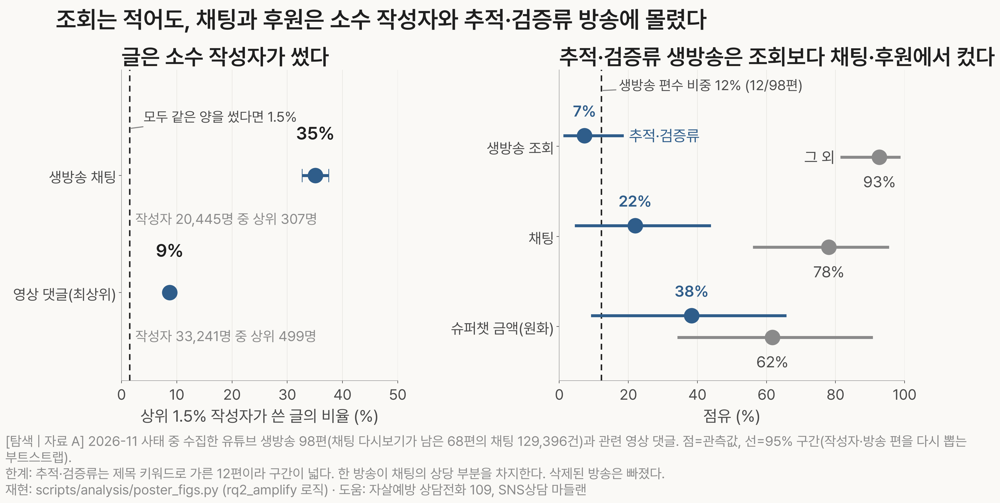

# 리트냥이 사태, 온라인에서 무슨 일이 있었나 (공유용 1쪽)

2026년 11월, 한 시험 고득점자를 둘러싼 부정 의혹이 온라인에서 빠르게 번졌고, 당사자가 숨지는 일로 이어졌습니다. 이 연구는 그 기간 공개적으로 보이던 디시인사이드와 유튜브의 글·영상·채팅을 모아, 어떤 속도와 말투로 번졌는지 살폈습니다. 자료는 유튜브 영상 287편과 디시인사이드 글 1만 건 이상입니다. 결과를 보기 전에 가설을 미리 등록하고, 새로 뽑은 표본으로 확인했습니다. 죽음 뒤에도 공격하는 글의 비율이 줄었다는 증거는 없었습니다(38.9%에서 42.5%). 생방송 채팅은 작성자 상위 1.5%가 전체의 35%를 썼습니다. 추적·검증류 생방송은 조회보다 채팅과 후원에서 몫이 컸지만, 어떤 방송과 비교하느냐에 따라 결과가 뒤집혀 잠정으로만 적었습니다. 반대로 사건 전부터 자해·자살 언급이 늘었다는 처음의 발견은 새 표본에서 되풀이되지 않아 결론에서 뺐습니다. 모든 숫자는 공개된 글에 한정되고, 사람이 직접 검증한 코딩은 아직 없습니다.

## 핵심 3가지
1. 공격은 죽음 뒤에도 줄지 않았다 (확증). 줄었다는 증거가 없다는 뜻이며, 늘었다고 말할 수는 없다.
2. 글과 채팅은 소수가 키웠다 (확증). 채팅 상위 1.5% 작성자가 35%를 썼다.
3. 사건 전 위험 신호가 늘었다는 처음 발견은 새 표본에서 재현되지 않았다 (판정 보류).

## 우리가 말할 수 없는 것
- 한국 여론이나 침묵하는 다수의 생각은 말할 수 없다.
- 누가 누구에게 영향을 줬는지, 원인과 결과는 말할 수 없다.
- 사람이 직접 확인한 코딩이 없어 '공격'의 정의는 아직 AI 기준이다.

범위: 2026-11 사태 동안 공개적으로 보이던 유튜브·디시인사이드·네이트판 담론(11/19부터 수집). 수집 전 삭제된 글은 포함되지 않는다.

자살예방 상담전화 ☎109, SNS상담 마들랜
